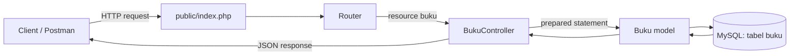

# API Buku

API Buku memakai front controller dan router aplikasi. Pastikan Apache dan MySQL aktif. Untuk database yang sudah ada, jalankan bagian `CREATE TABLE buku` pada `database/schema.sql` sebelum menguji endpoint.

## Struktur Folder MVC

```text
acara17/
|-- app/
|   |-- config/Database.php
|   |-- Core/autoload.php
|   |-- Core/Router.php
|   |-- Controllers/BukuController.php
|   |-- Models/Buku.php
|   |-- Repositories/
|   |-- Services/
|-- config/database.php
|-- database/schema.sql
|-- public/
|   |-- index.php
|   |-- .htaccess
|   `-- views/
|       |-- layouts/
|       `-- mahasiswa/
|-- routes/
|   `-- web.php
`-- api/mahasiswa.php
```

Folder `app/` tetap berada di luar `public/`, sedangkan `views/` berada di dalam `public/` sesuai struktur praktikum. Jangan simpan kredensial atau logika sensitif di file view. Pada deployment, arahkan document root web server ke `public/` agar folder aplikasi `app/` tidak dapat diakses langsung.

## Endpoint

Base URL lokal:

```text
http://localhost/BKPM-WEB-ALEXX/acara17/public/api/buku
```

Untuk POST dan PUT, gunakan header `Content-Type: application/json`.

| Method | Alamat | Keterangan |
| --- | --- | --- |
| GET | `/api/buku` | Mengambil semua buku |
| GET | `/api/buku/{id}` | Mengambil satu buku |
| POST | `/api/buku` | Menambahkan buku |
| PUT | `/api/buku/{id}` | Mengubah buku |
| DELETE | `/api/buku/{id}` | Menghapus buku |

Field wajib untuk POST dan PUT: `judul`, `penulis`, `penerbit`, dan `tahun_terbit`.

## Contoh Request dan Response

### POST `/api/buku`

Request body:

```json
{
  "judul": "Belajar PHP",
  "penulis": "Andi Saputra",
  "penerbit": "Pustaka Web",
  "tahun_terbit": 2025
}
```

Response `201 Created`:

```json
{
  "success": true,
  "message": "Data buku berhasil ditambahkan",
  "data": {
    "id": 1,
    "judul": "Belajar PHP",
    "penulis": "Andi Saputra",
    "penerbit": "Pustaka Web",
    "tahun_terbit": 2025,
    "created_at": "2026-10-20 10:00:00"
  }
}
```

### GET `/api/buku`

Response `200 OK` menggunakan array objek buku pada `data`:

```json
{
  "success": true,
  "message": "Data buku berhasil diambil",
  "data": [
    {
      "id": 1,
      "judul": "Belajar PHP",
      "penulis": "Andi Saputra",
      "penerbit": "Pustaka Web",
      "tahun_terbit": 2025,
      "created_at": "2026-10-20 10:00:00"
    }
  ]
}
```

### GET `/api/buku/1`

Response `200 OK`:

```json
{
  "success": true,
  "message": "Data buku berhasil diambil",
  "data": {
    "id": 1,
    "judul": "Belajar PHP",
    "penulis": "Andi Saputra",
    "penerbit": "Pustaka Web",
    "tahun_terbit": 2025,
    "created_at": "2026-10-21 10:00:00"
  }
}
```

### PUT `/api/buku/1`

Request body:

```json
{
  "judul": "Belajar PHP Lanjutan",
  "penulis": "Andi Saputra",
  "penerbit": "Pustaka Web",
  "tahun_terbit": 2026
}
```

Response `200 OK`:

```json
{
  "success": true,
  "message": "Data buku berhasil diperbarui",
  "data": {
    "id": 1,
    "judul": "Belajar PHP Lanjutan",
    "penulis": "Andi Saputra",
    "penerbit": "Pustaka Web",
    "tahun_terbit": 2026,
    "created_at": "2026-10-21 10:00:00"
  }
}
```

### DELETE `/api/buku/1`

Response `200 OK`:

```json
{
  "success": true,
  "message": "Data buku berhasil dihapus",
  "data": {
    "id": 1,
    "judul": "Belajar PHP Lanjutan",
    "penulis": "Andi Saputra",
    "penerbit": "Pustaka Web",
    "tahun_terbit": 2026,
    "created_at": "2026-10-21 10:00:00"
  }
}
```

ID yang tidak ditemukan menghasilkan `404 Not Found`; JSON atau field yang tidak valid menghasilkan `400 Bad Request`.

## Alur MVC



## Validasi NIM Mahasiswa

Validasi NIM duplikat sudah diterapkan pada `App\Models\Mahasiswa::create()` dan `update()`. Repository dan API juga memeriksa duplikasi, sedangkan indeks unik `uq_mahasiswa_nim` di database mencegah nilai duplikat tersimpan.